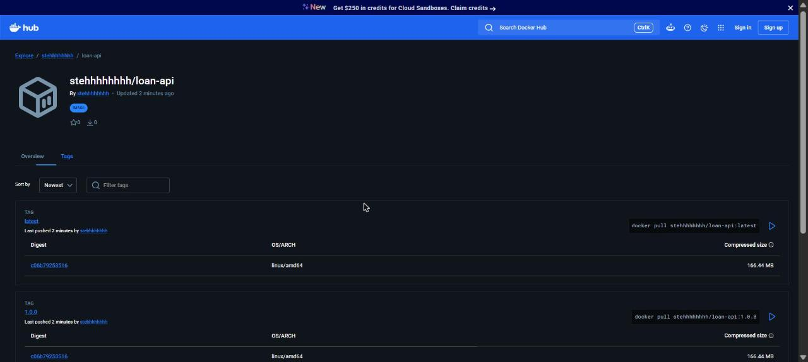
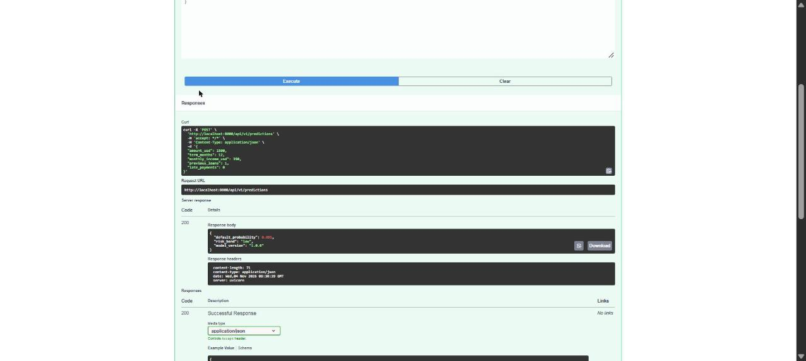

# CHECKLIST: Loan API production image

Evidence for each requirement of Lesson 4.7. Every block below is the real command and its output,
run locally with Docker Desktop on 2026-11-04. Raw outputs are also kept in [`evidence/`](evidence/).

## 1. Multi-stage Dockerfile.prod: slim base, non-root user, HEALTHCHECK

File: [`Dockerfile.prod`](Dockerfile.prod): stage 1 `FROM python:3.12-slim AS builder` installs packages into
`/opt/venv` and trains the model; stage 2 starts again from `python:3.12-slim`, creates `appuser`
(uid 1000), copies only `/opt/venv`, `model.joblib`, `main.py` and `schemas.py`, switches with `USER appuser`
and adds a `HEALTHCHECK` that calls `/health` with Python's built-in `urllib`.

```text
$ docker run -d --name prod -p 8000:8000 loan-api:prod
b7b6b466295ffae3e25c409438d8b509b39a53a089bdbe9b9b718d27a005265c
$ docker exec prod whoami
appuser
$ sleep 35 && docker ps --filter name=prod
NAMES     IMAGE           STATUS                    PORTS
prod      loan-api:prod   Up 38 seconds (healthy)   0.0.0.0:8000->8000/tcp, [::]:8000->8000/tcp
$ docker exec loan-api:slim whoami (for comparison)
root
```

`whoami` prints **appuser** (the single-stage `loan-api:slim` prints `root`), and the status shows **(healthy)**.

## 2. .dockerignore excludes Git, caches, local models and dev config

File: [`.dockerignore`](.dockerignore)

```text
# Git history
.git
.gitignore

# Virtual environments and caches
.venv
__pycache__/
*.pyc
.pytest_cache/

# Local models: the image trains its own with its own scikit-learn
model.joblib
models/

# Dev config and secrets
.devcontainer/
.vscode/
.env
*.env

# Not needed inside the image
tests/
CHECKLIST.md
evidence/
```

Git (`.git`), caches (`__pycache__/`, `*.pyc`, `.pytest_cache/`), local models (`model.joblib`, `models/`),
dev config (`.devcontainer/`, `.vscode/`) and secrets (`.env`) never enter the build context.

## 3. Model path configurable with MODEL_PATH

`main.py` reads `MODEL_PATH = os.getenv("MODEL_PATH", "model.joblib")` and loads `joblib.load(MODEL_PATH)`.
A 1.1.0 model is trained into `models/` and mounted read-only into the production image:

```text
$ python train.py --version 1.1.0 --out models/model.joblib   (run inside loan-api:slim, same pinned scikit-learn)
Saved model 1.1.0 to models/model.joblib (test AUC 0.923)

$ docker run -d --name m11 -p 8000:8000 -v "$(pwd)/models:/models:ro" -e MODEL_PATH=/models/model.joblib loan-api:prod
$ curl http://localhost:8000/health
{"status":"ok","model_version":"1.1.0"}
```

`/health` shows **1.1.0** without rebuilding the image.

## 4. compose.yaml runs API + PostgreSQL + Adminer, API built from Dockerfile.prod

File: [`compose.yaml`](compose.yaml): `api` uses `build: context: .` and `dockerfile: Dockerfile.prod`,
`db` is `postgres:17` with a health check, the `pgdata` volume and `init.sql`, and `adminer` is on port 8080.

```text
$ docker compose up -d --build
 Image loan-api-api Built 
 Container loan-api-db-1 Started 
 Container loan-api-adminer-1 Started 
 Container loan-api-db-1 Healthy 
 Container loan-api-api-1 Started 
$ sleep 35 && docker compose ps
SERVICE   IMAGE           STATUS                    PORTS
adminer   adminer:4.8.1   Up 42 seconds             0.0.0.0:8080->8080/tcp, [::]:8080->8080/tcp
api       loan-api-api    Up 35 seconds (healthy)   0.0.0.0:8000->8000/tcp, [::]:8000->8000/tcp
db        postgres:17     Up 42 seconds (healthy)   5432/tcp

$ curl http://localhost:8000/health
{"status":"ok","model_version":"1.0.0"}
$ docker compose exec db psql -U loans -d loans -c "SELECT count(*) FROM loan_applications;"
 count 
-------
     6
(1 row)
```

All three services are up; **api and db are (healthy)**, and the seed data from `init.sql` is loaded (6 applications).

## 5. Image at least 40% smaller than the full-Python variant

`Dockerfile.full` is the Lesson 4.3 Dockerfile with `FROM python:3.12` instead of `python:3.12-slim`
(`sed 's/^FROM python:3.12-slim/FROM python:3.12/' Dockerfile > Dockerfile.full`).

```text
$ docker images loan-api
REPOSITORY:TAG   IMAGE ID       SIZE
loan-api:full    2a28cc337877   2.18GB
loan-api:slim    81883eef6951   757MB
loan-api:prod    2247058868a4   774MB

$ docker image inspect --format "{{.Size}}" (bytes, uncompressed)
loan-api:full  2181558044
loan-api:slim  756891961
loan-api:prod  774300425
prod is 64.5% smaller than full (774 MB vs 2182 MB)
```

**loan-api:prod is 64.5% smaller** than loan-api:full (requirement: at least 40%).

## 6. No HIGH or CRITICAL findings without a note explaining them

```text
$ docker run --rm -v /var/run/docker.sock:/var/run/docker.sock aquasec/trivy:0.69.3 image --severity HIGH,CRITICAL loan-api:prod
│ loan-api:prod (debian 13.7)                                                      │   debian   │       45        │    -    │
loan-api:prod (debian 13.7)
Total: 45 (HIGH: 45, CRITICAL: 0)
```

Full report: [`evidence/trivy.txt`](evidence/trivy.txt). Trivy is pinned to 0.69.3, the version the
GHSA-69fq-xp46-6x23 advisory lists as safe.

- **Python packages: 0 HIGH, 0 CRITICAL.**
- **Debian 13 base packages: 45 HIGH, 0 CRITICAL**, from 9 distinct CVEs. **None has a fixed version** in
  Debian yet (44 are `affected`, 1 is `fix_deferred`), so rebuilding with `docker build --pull` or changing
  our pinned Python packages cannot remove them today. The image was built on the newest
  `python:3.12-slim` available on 2026-11-04.

| CVE | Package(s) | Note |
|---|---|---|
| CVE-2026-76642, CVE-2026-78408, CVE-2026-78409, CVE-2026-78410 | util-linux family (mount, libmount1, libblkid1, login, …) | Not fixable yet. All four need mounting, `nsenter` or login inside the container; the API never runs these tools, the container runs as non-root `appuser`, and Docker does not grant the mount capability. Low practical risk. |
| CVE-2026-16742 | libsystemd0, libudev1 | Not fixable yet. The flaw is in `systemd-homed`, which is not installed or running in the container (only the client libraries are present as dependencies). |
| CVE-2026-54369 | libacl1 | Not fixable yet. Needs a local attacker who can create symlinks in paths a privileged process walks; the app only reads its own files as `appuser`. |
| CVE-2025-69720 | ncurses (libncursesw6, libtinfo6, ncurses-base, ncurses-bin) | Not fixable yet. Triggered by crafted terminal data; the API never draws a terminal UI. |
| CVE-2026-119373 | libsqlite3-0 | Not fixable yet. The API does not use SQLite (it uses in-memory data and PostgreSQL). |
| CVE-2026-9538 | perl-base (Archive::Tar) | `fix_deferred` by Debian. Needs Perl to unpack an attacker's tar file; the API never runs Perl. |

Action: re-scan regularly and rebuild with `docker build --pull` as soon as Debian publishes fixed versions.

## 7. Image published as stehhhhhhhh/loan-api:1.0.0 and :latest

Docker Hub repository: **https://hub.docker.com/r/stehhhhhhhh/loan-api** (tags page:
https://hub.docker.com/r/stehhhhhhhh/loan-api/tags)

```text
$ DOCKER_USER=stehhhhhhhh
$ docker build -t loan-api:prod -f Dockerfile.prod .
sha256:b648f1a04ace8677630b33596bdc072e46c2b85a1497841f430ac8029caa4306
$ docker tag loan-api:prod $DOCKER_USER/loan-api:1.0.0
$ docker tag loan-api:prod $DOCKER_USER/loan-api:latest
$ docker push $DOCKER_USER/loan-api:1.0.0
The push refers to repository [docker.io/stehhhhhhhh/loan-api]
44136fa355b3: Pushed
f600b8f650dd: Pushed
3eb771151506: Pushed
acca7542dfc7: Pushed
4974ff71f1fa: Pushed
df10288e2817: Pushed
1545e338afcc: Pushed
245d8dcf52ec: Pushed
f574edac59d9: Pushed
6fc242d221a6: Pushed
91ffcc555f17: Pushed
1.0.0: digest: sha256:b648f1a04ace8677630b33596bdc072e46c2b85a1497841f430ac8029caa4306 size: 856
$ docker push $DOCKER_USER/loan-api:latest
The push refers to repository [docker.io/stehhhhhhhh/loan-api]
3eb771151506: Layer already exists
44136fa355b3: Already exists
f600b8f650dd: Already exists
6fc242d221a6: Layer already exists
acca7542dfc7: Layer already exists
4974ff71f1fa: Layer already exists
f574edac59d9: Layer already exists
df10288e2817: Layer already exists
91ffcc555f17: Layer already exists
1545e338afcc: Layer already exists
245d8dcf52ec: Layer already exists
latest: digest: sha256:b648f1a04ace8677630b33596bdc072e46c2b85a1497841f430ac8029caa4306 size: 856
```

The second push prints `Layer already exists` for every layer: both tags point to the same image.



## The published image runs without any local files (Lesson 4.7, Hands-on 4)

```text
$ docker compose down
$ docker rmi $DOCKER_USER/loan-api:1.0.0 $DOCKER_USER/loan-api:latest loan-api:prod
Untagged: stehhhhhhhh/loan-api:1.0.0
Untagged: stehhhhhhhh/loan-api:latest
Untagged: loan-api:prod
Deleted: sha256:b648f1a04ace8677630b33596bdc072e46c2b85a1497841f430ac8029caa4306
$ docker images stehhhhhhhh/loan-api   (empty: no local copy)
IMAGE   ID             DISK USAGE   CONTENT SIZE   EXTRA
$ docker run --rm -p 8000:8000 $DOCKER_USER/loan-api:1.0.0
Unable to find image 'stehhhhhhhh/loan-api:1.0.0' locally
1.0.0: Pulling from stehhhhhhhh/loan-api
44136fa355b3: Already exists
f600b8f650dd: Download complete
Digest: sha256:b648f1a04ace8677630b33596bdc072e46c2b85a1497841f430ac8029caa4306
Status: Downloaded newer image for stehhhhhhhh/loan-api:1.0.0
INFO:     Application startup complete.
INFO:     Uvicorn running on http://0.0.0.0:8000 (Press CTRL+C to quit)

$ curl -X POST http://localhost:8000/api/v1/predictions -H "Content-Type: application/json" -d {example body}
{"default_probability":0.095,"risk_band":"low","model_version":"1.0.0"}
HTTP 200
```

`Unable to find image ... locally`, then the pull from Docker Hub, then Uvicorn on `0.0.0.0:8000`,
and the prediction answers **200**.



## Secrets

No secrets are in the image or the repository. The only password is the development-only
`POSTGRES_PASSWORD: loans_dev_only` in `compose.yaml`, which the task allows. The Docker Hub access token
was used only for `docker login` and is not stored in any file. `.dockerignore` also excludes `.env` files.

